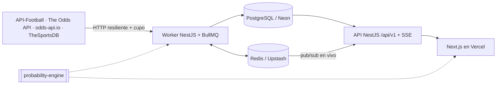

# ORACLE ODDS

Plataforma de **inteligencia de cuotas**: muestra partidos reales próximos y en vivo, compara cuotas de casas autorizadas, estima probabilidades con un modelo estadístico calibrado, detecta oportunidades de valor, construye combinadas simuladas, genera piezas para compartir y gestiona retos sociales sin dinero real.

> ORACLE ODDS ofrece estimaciones estadísticas y comparación informativa de cuotas. Ningún pronóstico garantiza un resultado. **No es un operador**: no recibe apuestas, no custodia fondos ni permite completar apuestas. Solo para mayores de 18 años. Jugar sin control puede generar adicción.

## Arquitectura



| Ruta | Contenido |
|---|---|
| `apps/web` | Next.js 15 + Tailwind: 13 páginas de producto + legales, SEO, piezas PNG/PDF (Satori/Resvg) |
| `apps/api` | NestJS: API pública, worker de sincronización (proceso separado), Prisma |
| `packages/probability-engine` | Motor puro: vig, EV, Kelly, Dixon-Coles, Elo, calibración, métricas, combinadas, liquidación |
| `docs/` | Arquitectura, proveedores, metodología, validación, normalización, cumplimiento, despliegue, runbook |
| `ops/` | Alertas Prometheus y dashboard Grafana |

Detalle: [docs/architecture.md](docs/architecture.md).

## Proveedores

| Proveedor | Variable | Rol |
|---|---|---|
| API-Football | `API_FOOTBALL_KEY` | Partidos, en vivo, resultados, estadísticas, eventos, alineaciones, lesiones, clasificaciones |
| The Odds API | `THE_ODDS_API_KEY` | Cuotas de múltiples casas (1X2/moneyline, hándicaps, totales), resultados, histórico (plan pago) |
| odds-api.io | `ODDS_API_IO_KEY` + `ENABLE_ODDS_API_IO` | Cobertura adicional opcional |
| TheSportsDB | `THESPORTSDB_KEY` | Solo escudos y metadatos |

Cómo obtener las claves, límites de cada plan y ajuste de frecuencias: [docs/data-providers.md](docs/data-providers.md). **Sin claves la plataforma arranca y muestra un estado honesto ("fuentes sin configurar"); nunca inventa partidos, cuotas ni resultados.**

## Desarrollo local

Requisitos: Node ≥ 22, Docker.

```bash
npm install
docker compose up -d                      # Postgres 16 + Redis 7
cp apps/api/.env.example apps/api/.env    # completa claves si las tienes
cp apps/web/.env.local.example apps/web/.env.local
npm run build -w packages/probability-engine
npm run db:generate
npm run db:deploy                         # aplica migraciones
npm run db:seed                           # SOLO desarrollo: deportes y definiciones de mercado (sin partidos)

npm run dev:api                           # API en http://localhost:3001 (Swagger: /api/docs)
npm run dev:worker                        # worker (requiere Redis)
npm run dev:web                           # web en http://localhost:3000
```

Sin worker, ejecuta jobs a mano sobre el build: `npm run build -w apps/api && npm run job -- sync:sports-catalog sync:upcoming-fixtures sync:prematch-odds compute:predictions compute:value-bets`.

### Migraciones

- `npm run db:migrate` crea migraciones en desarrollo; `npm run db:deploy` las aplica (producción la ejecuta la API al arrancar).
- La migración `20261014120000_production_platform` es **no destructiva**: las tablas anteriores de cuotas/probabilidades pasan a `legacy_*` con sus filas; los partidos previos sin procedencia quedan ocultos y se pueden purgar explícitamente con `npm run data:purge-unverified -w apps/api -- --confirm`.

### Workers

17 jobs (`sync:*`, `compute:*`, `export:social-card`) con frecuencias configurables, locks distribuidos, reintentos con backoff, dead-letter queue, `SyncRunLog` y `lastSuccessfulSync` por proveedor. Ver [docs/operations-runbook.md](docs/operations-runbook.md).

## Pruebas

```bash
npm test                    # unitarias: motor (66) + API (39)
npm run test:integration    # integración contra Postgres real (TEST_DATABASE_URL, por defecto oracle_odds_test)
npm run test:e2e            # Playwright: levanta API + web contra oracle_odds_e2e cargada con respuestas grabadas
npm run lint && npm run typecheck && npm run build
```

Las pruebas nunca dependen de APIs externas: usan respuestas grabadas con el formato de cada proveedor (`apps/api/test/fixtures`, equipos ficticios) que solo existen en el entorno de pruebas. La prueba E2E con datos reales se activa con `E2E_REAL_BASE_URL`.

## Despliegue

Frontend en **Vercel**; API y worker en **Render** (Blueprint `render.yaml`, misma imagen Docker con `PROCESS_ROLE=api|worker`); Postgres en **Neon**; Redis en **Upstash**. Paso a paso, backups y variables obligatorias: [docs/deployment.md](docs/deployment.md).

## Variables de entorno

Referencia completa y comentada: [`.env.example`](.env.example) (API, worker y web). Claves: `DATABASE_URL`, `DATABASE_URL_UNPOOLED`, `REDIS_URL`, `ENABLE_SYNC_WORKER`, `SYNC_ADMIN_SECRET`, `ANON_HASH_SALT`, `INTERNAL_API_TOKEN`, `CORS_ORIGIN`, `API_FOOTBALL_KEY`, `TRACKED_LEAGUES`, `THE_ODDS_API_KEY`, `ODDS_SPORT_KEYS`, `ALLOWED_BOOKMAKERS`, `ODDS_API_IO_KEY`, `THESPORTSDB_KEY`, `DEFAULT_TIMEZONE`, `DEFAULT_LOCALE`, `DEFAULT_REGION`, `BET_SANTANDER_*`, `NEXT_PUBLIC_API_URL`. La API valida todo al arrancar.

## Metodología

Ensemble versionado (Dixon-Coles + Elo + consenso de mercado sin margen), sin fuga de información, calibrado y evaluado walk-forward (Brier, log loss, ECE). Un mercado solo se publica con muestra suficiente y buena calibración. Las oportunidades se ordenan por **calidad**, no por probabilidad. Ver [docs/prediction-methodology.md](docs/prediction-methodology.md), [docs/model-validation.md](docs/model-validation.md) y [docs/odds-normalization.md](docs/odds-normalization.md).

## Cumplimiento y juego responsable

Age gate 18+ sin cuenta, avisos permanentes, divulgación de afiliación, solo operadores autorizados (`ALLOWED_BOOKMAKERS`), historial público con pérdidas, bankroll prudente (Kelly 0.25, máx. 2 u), retos sin dinero y patrocinio BetSantander desactivado hasta verificar operador, licencia y acuerdo. Ver [docs/responsible-gambling.md](docs/responsible-gambling.md) y [docs/affiliate-compliance.md](docs/affiliate-compliance.md).

## Troubleshooting

| Síntoma | Causa probable |
|---|---|
| La web dice "Fuentes de datos sin configurar" | Faltan `API_FOOTBALL_KEY`/`THE_ODDS_API_KEY` en la API |
| "Datos temporalmente no disponibles" | La web no alcanza la API: revisa `NEXT_PUBLIC_API_URL`/`API_URL` y `CORS_ORIGIN` |
| No aparecen cuotas | `ALLOWED_BOOKMAKERS` vacío o sin las casas del proveedor; `ODDS_SPORT_KEYS` vacío |
| No hay oportunidades | Mercados aún sin validación fuera de muestra (normal al inicio) o umbrales `VALUE_MIN_*` |
| Job `SKIPPED (PROVIDER_NOT_CONFIGURED…)` | Falta la clave del proveedor de ese job |
| `QuotaExceededError` | Cupo diario agotado: baja frecuencias o sube de plan |
| El worker no arranca | Requiere `REDIS_URL`/`REDIS_HOST` |
| 429 en SSR | Configura el mismo `INTERNAL_API_TOKEN` en API y web |

## Roadmap

- Modelos para baloncesto y tenis (las interfaces existen; hoy solo comparación de cuotas).
- Ritmo en vivo con estadísticas del partido en curso y oportunidades en vivo validadas.
- Streaming WebSocket de odds-api.io; histórico de cuotas para backtests de CLV.
- Envío real de newsletter (proveedor transaccional) y Web Push opcional.
- API B2B con claves por cliente y white-label para medios.
- Actualización a NestJS 11 y dependencias con avisos de `npm audit` que requieren cambios mayores.

## Licencia

Propietaria. © ORACLE ODDS. Todos los derechos reservados.
