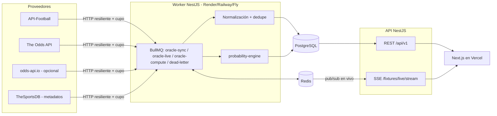

# Arquitectura

ORACLE ODDS es un monorepo npm workspaces con tres piezas y dos procesos de backend.

| Pieza | Ruta | Rol |
|---|---|---|
| Frontend | `apps/web` | Next.js 15 (App Router) + Tailwind. Render en servidor, sin cuentas. Despliegue: Vercel. |
| API | `apps/api` (`src/main.ts`) | NestJS 10. Endpoints públicos `/api/v1`, SSE en vivo, `/health`, `/ready`, `/metrics`, Swagger en `/api/docs`. |
| Worker | `apps/api` (`src/worker.ts`) | Mismo código, proceso persistente que consume colas BullMQ y programa los 17 jobs. Nunca corre en funciones serverless. |
| Motor | `packages/probability-engine` | TypeScript puro y determinista: cuotas, vig, modelos, calibración, métricas, combinadas, liquidación. |
| Datos | PostgreSQL (Neon) + Redis (Upstash) | Prisma 5. Redis solo para colas, locks y pub/sub en vivo. |

## Flujo de datos

1. **Ingesta**: cada job pide datos al proveedor a través de `ProviderHttpClient` (timeout, reintentos con backoff+jitter, `Retry-After`, circuit breaker, token bucket y cupo diario en Postgres).
2. **Normalización**: los adaptadores convierten respuestas a tipos normalizados (`providers/types.ts`). `EntityResolverService` resuelve a IDs canónicos vía `ProviderEntityMap` y deduplica partidos (ver `odds-normalization.md`).
3. **Persistencia idempotente**: `IngestionService` hace upserts; las cuotas generan un `OddsSnapshot` solo cuando el precio cambia y mantienen `OddsQuote` (apertura/anterior/actual).
4. **Cómputo**: `compute:predictions` corre el ensemble con datos anteriores al corte; `compute:value-bets` compara con cuotas vigentes; `compute:model-metrics` hace el backtest walk-forward y calibra.
5. **Liquidación**: `sync:settlements` cierra oportunidades al inicio (precio de cierre/CLV) y liquida con el resultado oficial.
6. **Exposición**: la API sirve solo partidos con procedencia (`primaryProvider` no nulo). El frontend nunca sustituye datos ausentes.

## Procesos y escalado

- La API es stateless y escala horizontalmente. El SSE escucha el canal Redis `oracle-odds:live`.
- El worker usa **locks distribuidos** por job: varias réplicas no ejecutan el mismo job en paralelo.
- Jobs repetibles mediante `upsertJobScheduler` (frecuencias en variables `SYNC_*`/`COMPUTE_*`).
- Jobs que agotan reintentos van a la cola `oracle-dead-letter` con su error.
- `npm run job -- <job>` ejecuta jobs una vez sin Redis (operación manual / cron externo).

## Módulos de la API (`apps/api/src/modules`)

`normalization`, `ingestion`, `sync` (runner, jobs, colas), `catalog`, `predictions`, `value-bets`, `settlement`, `model-metrics` (backtest, calibración, política de publicación), `track-record`, `fixtures`, `live`, `combinations`, `share`, `challenges`, `affiliate` (patrocinio y clics), `admin`, `health`, `data-status`, `newsletter`. Todos comparten `CoreModule`; `AppModule` añade controladores HTTP y `WorkerModule` el consumidor de colas.

## Decisiones

- **Sin login**: el producto es anónimo. Las tablas de usuarios de la versión anterior se conservan sin endpoints.
- **Datos legados**: los partidos sembrados por el seed antiguo quedan con `primaryProvider = NULL` y nunca se exponen; `npm run data:purge-unverified -w apps/api -- --confirm` los elimina explícitamente.
- **Motor puro**: ninguna E/S en `probability-engine`; facilita pruebas y auditoría.
